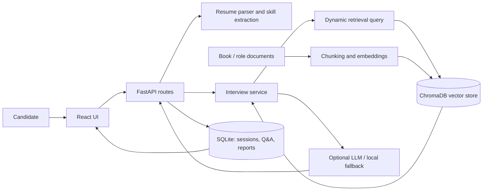

# RoleWise AI — Resume-Aware Technical Interview Studio

A full-stack practice platform for structured, role-based technical interviews. It uses a candidate's resume, a selected role, and a local role knowledge base to create questions; stores the interview lifecycle; and produces a reviewable report.

> **Important knowledge-base setup:** The assignment names specific machine-learning books as the primary RAG sources, but the assignment PDF does not include the book files themselves. The repository contains short original starter notes so the demo can run immediately. For a final submission, add the permitted book PDF you selected (for example, *The Hundred-Page Machine Learning Book*) to `backend/data/knowledge_base/` and re-index it. Do not represent the starter notes as excerpts from that book.

## Features

- PDF/TXT resume upload and text extraction
- Lightweight skill identification and candidate-name extraction
- Four interview tracks: AI/ML Engineer, Backend Engineer, Python Developer, Full Stack Developer
- Resume- and role-aware retrieval queries
- RAG ingestion: PDF/Markdown/text loading, overlapping chunking, sentence-transformer embeddings, ChromaDB vector persistence, semantic retrieval and source metadata
- Six-question interview lifecycle with progressive topic/difficulty selection
- Answer persistence, feedback and indicative scores
- Final report with score, strengths, development areas and question-by-question transcript
- Optional OpenAI generation/evaluation; deterministic local fallback keeps the workflow usable without an API key
- SQLite persistence, validation, error handling and environment-based configuration

## Architecture



### Main backend modules

- `app/main.py` — API routes and interview lifecycle orchestration
- `app/services/resume.py` — resume extraction and skill parsing
- `app/services/rag.py` — ingestion, chunking, embeddings, vector indexing and retrieval
- `app/services/interview.py` — dynamic question creation and answer evaluation
- `app/models/entities.py` — SQLAlchemy persistence models
- `app/core/config.py` — environment configuration

## Requirements

- Python 3.11+
- Node.js 20+
- 4 GB+ RAM recommended for the first embedding-model download
- Optional OpenAI API key for LLM-generated questions and richer evaluation

## Run locally

### 1. Backend

```bash
cd backend
python -m venv .venv
# Windows PowerShell: .venv\Scripts\Activate.ps1
# macOS/Linux: source .venv/bin/activate
pip install -r requirements.txt
copy .env.example .env   # Windows; use cp .env.example .env on macOS/Linux
uvicorn app.main:app --reload
```

Backend: `http://localhost:8000`  
Swagger API docs: `http://localhost:8000/docs`

The first startup downloads the configured sentence-transformer embedding model if it is not already cached. The initial knowledge-base documents are indexed automatically when the collection is empty.

### 2. Frontend

In a second terminal:

```bash
cd frontend
npm install
npm run dev
```

Frontend: `http://localhost:5173`

If the API runs at another address, create `frontend/.env` with:

```env
VITE_API_URL=http://localhost:8000
```

### 3. Add the assignment's primary book source

1. Obtain the book PDF through a source/license that permits your use.
2. Copy the PDF into `backend/data/knowledge_base/` (for example, `machine_learning_reference.pdf`).
3. Re-index the folder:

```bash
cd backend
python ../scripts/ingest_knowledge.py
```

Or call `POST /api/knowledge/ingest` after starting the backend. The collection stores each chunk with source filename and chunk index metadata. For an ML-only corpus, use the AI/ML track; for a multi-role corpus, add separate files with `ai_ml` or `backend` in their filenames to enable role metadata filters. Files without a role marker are treated as general material.

## Run with Docker Compose

From the repository root:

```bash
docker compose up --build
```

Open `http://localhost:5173` and `http://localhost:8000/docs`. To enable OpenAI, set `OPENAI_API_KEY` in the root `.env` file before starting Compose. The embedding model is downloaded on first backend start.

## Run tests

```bash
cd backend
python -m pytest -q
```

## Environment variables

| Variable | Purpose | Default |
|---|---|---|
| `DATABASE_URL` | SQLAlchemy database URL | `sqlite:///./rolewise.db` |
| `CHROMA_PATH` | Persistent ChromaDB directory | `./data/chroma` |
| `KNOWLEDGE_BASE_PATH` | Documents to ingest | `./data/knowledge_base` |
| `EMBEDDING_MODEL` | Sentence-transformer model | `sentence-transformers/all-MiniLM-L6-v2` |
| `OPENAI_API_KEY` | Optional generation/evaluation key | empty |
| `OPENAI_MODEL` | Optional chat model | `gpt-4o-mini` |
| `FRONTEND_ORIGIN` | CORS origin | `http://localhost:5173` |
| `MAX_UPLOAD_MB` | Resume upload limit | `10` |

Never commit `.env` or API keys.

## API overview

| Method | Endpoint | Purpose |
|---|---|---|
| GET | `/api/health` | Health check |
| GET | `/api/roles` | Supported interview roles |
| POST | `/api/knowledge/ingest` | Re-index local knowledge documents |
| POST | `/api/sessions` | Upload resume and create session (`multipart/form-data`: `role`, `resume`) |
| POST | `/api/sessions/{id}/start` | Start or resume interview and return current question |
| POST | `/api/sessions/{id}/answer` | Save answer, evaluate it and return next question |
| GET | `/api/sessions/{id}/report` | Retrieve completed interview report |

## Data flow and design decisions

1. The resume parser extracts text from PDF/TXT, then identifies a bounded set of skills using a transparent keyword list.
2. The role and resume excerpt are combined into a retrieval query. Previous answers are included after the first response so later questions can take the candidate's direction into account.
3. The RAG service chunks local documents with overlap, embeds them using a sentence-transformer model, and persists vectors in ChromaDB. Retrieved text and source metadata are attached to each question record for traceability.
4. When `OPENAI_API_KEY` is configured, an LLM creates questions and evaluates answers using retrieved context. Without it, a local fallback creates contextual role/topic prompts and provides heuristic feedback. The fallback score is a practice signal, not a validated assessment metric.
5. SQLite stores sessions, questions, answers, scores, feedback and reports. The API controls the lifecycle and the React client renders each state.

## Known limitations and sensible next steps

- Resume skill extraction is keyword-based; production use should add structured extraction and human verification.
- The local fallback evaluator is heuristic. It should not be used for hiring decisions. LLM evaluation should be calibrated against a reviewed rubric and sample answers.
- The starter corpus is not a substitute for the assignment's selected book. Add and index the actual primary source before recording the final demo.
- The demo uses a local SQLite database and a single Chroma collection. A deployed multi-user service should add authentication, per-user access control, retention/deletion controls, rate limits, observability and managed persistence.
- Add unit/integration tests for parsing, retrieval relevance, session concurrency, and evaluation quality before production deployment.

## Demo video checklist

Record a 3–5 minute screen capture showing:

1. Start the backend and frontend; open the app.
2. Select a target role and upload a sample resume.
3. Show the parsed skills/session and start the interview.
4. Answer at least two questions; show feedback and the next question.
5. Complete all six questions and open the report/transcript.
6. Briefly show `/docs`, the knowledge-base directory and the project architecture.

Do not show API keys, private resumes, or personal data in the recording.

## License

For assessment/demo use. Add an explicit license before public redistribution.

For Docker Compose, copy the root `.env.example` to `.env` if you want to configure an optional API key. Without it, the local fallback is used.
